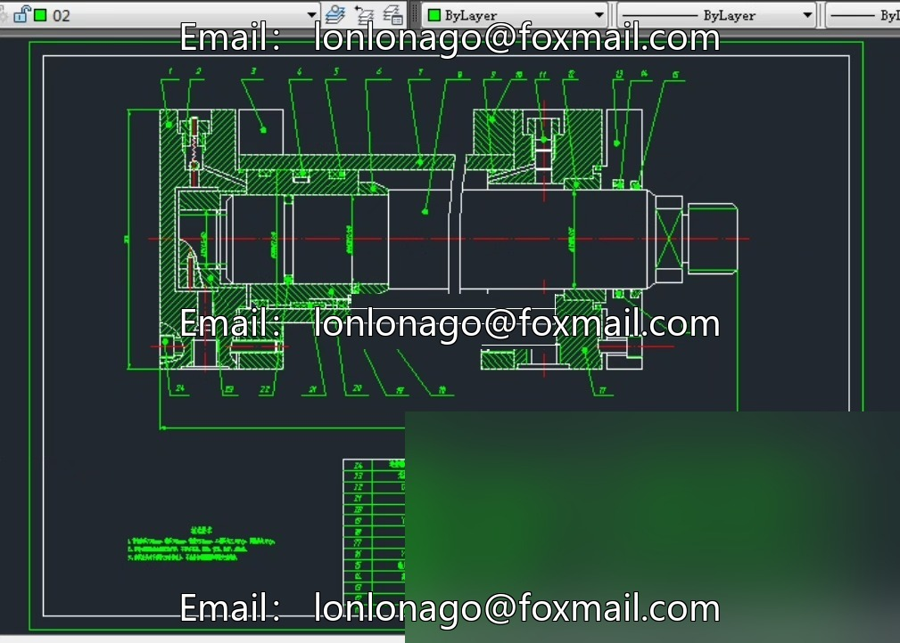

# Correction press assembly hydraulic machine hydraulic system design correction press assembly hydraulic machine hydraulic system design diagram school

## Body

1. Calibrated press hydraulic machine hydraulic system design
1. Calibrated press hydraulic machine hydraulic system design diagram
1. Calibrated press hydraulic machine hydraulic system design CAD diagram
418 Design requirements: the working cycle is a rapid downward → slow pressure applied → rapid return → stop. Pressing working speed shall not exceed 5 mm/s, and the rapid downward speed should be 8-10 times that of the working speed, and the workpiece pressure shall be not less than 10 KN

The content covers the hydraulic design system and design drawings for the correction press-stacking hydraulic machine, along with CAD drawings, design tasks, load and speed analysis requirements.

<!-- AI_ENRICHED -->

## Images

## Payment

Here is a pay link on Stripe ( https://buy.stripe.com/3cs8yP7sY87d0vu9AB ). Please contact me lonlonago@foxmail.com after funding $89, and I will send you a complete data files , thank you!

